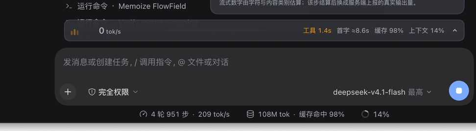
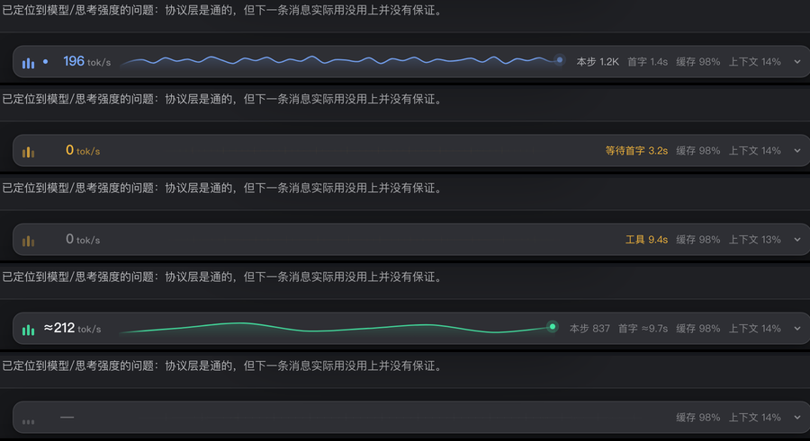
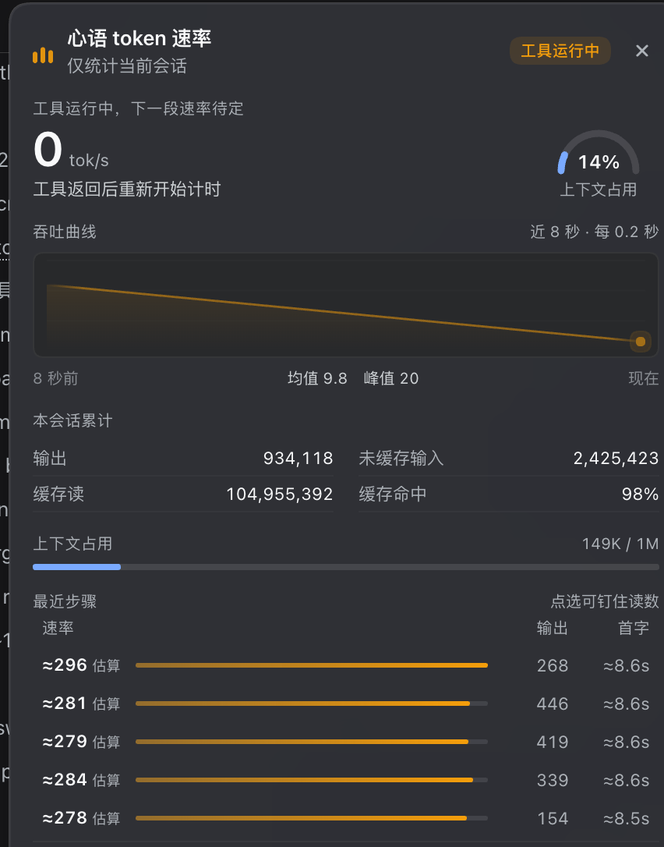

# Xinyu Token Rate · dsh-xinyu-token-rate

A token-throughput gauge that docks above the composer in DeepSeek Harness. It answers one question at a glance: **how fast is this generation going, how long did the first token take, how much of the prompt was cached, and how full is the context window.**

No core changes, no network requests, no build step — a pure client plugin that occupies exactly one slot, `conversation.input.dock`.



## What it shows

One 36 px strip, aligned to the composer width. Left to right: a state mark, the **rate**, an 8-second throughput curve, four explanatory chips, and a chevron. The whole strip is clickable.



| State | Reads | Notes |
| --- | --- | --- |
| Writing | live rate + sliding curve | Blue waveform tracking the last one-second window |
| Waiting for first token | `0 tok/s` + `waiting 3.2s` | Amber; a ticked hairline baseline breathes |
| Tool running | `0 tok/s` + `tool 9.4s` | No tokens are produced, so no fake spike from the previous step |
| Settled | `≈212 tok/s` | Derived from the real usage the provider reported |
| Idle | `—` | Completely static, 0% CPU |

## The panel



- **Last step average** as the hero number, with a semicircular context-pressure gauge
- **Last 8 seconds**: one bar per 0.2 s with mean and peak. Drag across the curve to read any single bar's rate and how long ago it was
- **Session totals**: output, uncached input, cache read, cache hit rate
- **Recent steps**: rate, output tokens, time to first token per step. Click any row to pin it to the hero number; click again to release

## Install

### Option 1 — from the DSH plugin page (recommended)

In DSH's **Plugins** page, install from a local directory and point it at your clone. The package ships its own `cordis.patch.yml` and declares `dsh.bundle.patch`, so it registers and mounts itself — no hand-written config.

### Option 2 — command line

```sh
# git dependency pinned to a tag
dsh plugin --profile desktop add 'dsh-xinyu-token-rate@github:su2517108202-blip/xinyu-token-rate#v1.2.1'

# or a local link, for development (edits hot-reload)
git clone https://github.com/su2517108202-blip/xinyu-token-rate.git
dsh plugin --profile desktop add link:$PWD/xinyu-token-rate
```

Refresh the browser afterwards (Cmd/Ctrl + R). With a link install the Host's HMR picks up every save of `client.js`, so you do not even need to refresh.

> **No build step.** `client.js` is the assembled browser bundle; there are no runtime dependencies, so `npm install` is never required.

### Let DSH install it for you

Paste this into any DSH session:

> Install the Xinyu Token Rate plugin: `git clone https://github.com/su2517108202-blip/xinyu-token-rate.git`, then use `plugin_manager` with `install_bundle` to install that directory into the current profile, and confirm the rate strip appears above the composer after a refresh.

## Where the numbers come from

The plugin only reads snapshots and projections the Host already exposes. It never calls an endpoint.

**While writing**, streamed characters are weighted by class (CJK, Latin, digits, code punctuation) and then calibrated with a ridge regression against the usage the provider reported for completed steps in the same session. Replaying 2,534 real steps: median final-token error **6.5%**, live windowed rate error **4.3%**.

**After settling**, the rate is the provider's own `outputTokens` divided by the decode window. But replayed steps carry no first-token timestamp — the Host only records it on the live stream — so the decode window is reconstructed from three quantities:

```
ln(decode_ms) = 4.8189 + 0.2902·ln(span) + 0.9687·ln(out) - 0.4987·ln(prompt)
```

Leave-one-session-out cross validation over 2,556 steps: median error **26%** (using the whole step span as the decode window instead: **59%**). **Every estimated value carries a `≈` prefix.** Per-row token counts are always the provider's real numbers, so totals stay exact even when a rate is estimated.

See [Benchmarks](#benchmarks) to reproduce this.

## Motion that does not cost a frame

Every animation is a CSS compositor animation (`opacity` / `transform`). There is no canvas and no per-frame JavaScript. The only timer is a 150 ms sample, and it only runs while the model is producing tokens.

| State | CPU delta (2× scale, GPU compositing, versus the same page without the plugin) |
| --- | --- |
| Idle / settled / error | **0%** |
| Writing | **~3%** |
| Waiting / tool running | **~3%** |

> On a 2× Retina display, a single 8 px dot doing the simplest `opacity` pulse already wakes the Chromium compositor for ~3% — that is the physical floor for keeping any live feedback. With "reduce motion" enabled in the OS, everything drops to zero.

Memory: V8 heap differs by **0.3 MB** from a build without the plugin, and it is one-time DOM and styles — the sliding window is truncated to 40 numbers and calibration scans at most 120 steps, so **it does not grow with conversation length**.

## Compatibility

| Item | Requirement |
| --- | --- |
| DSH | 0.2.x (developed and verified on 0.2.2-rc.3) |
| Platform | Web GUI (`dsh.client.platform = "web"`) |
| Host modules | `@deepseek-ai/dsh-client-locale`, `@deepseek-ai/dsh-client-ui-conversation` |
| Browser | Modern Chromium / Safari with `@layer`, `corner-shape`, `color-mix()` |

Slot: `conversation.input.dock` at `order: 15` (after goal, before queue). All styles live inside `@layer xinyu-token-rate` so they cannot leak into the Host's cascade, and every colour and dimension comes from the Host's `--dsw-*` / `--dsh-*` tokens, so it follows light and dark themes.

## Benchmarks

The repository ships a reproducible harness. It does not mock: it reads your local DSH session logs and scores the estimator that actually ships in `client.js`.

```sh
# 1. export sessions (needs zstd; logs contain your conversations, written to .sessions/ and git-ignored)
node scripts/extract-sessions.mjs

# 2. run both benchmarks
npm run bench
```

```
$ node bench/verify_client.mjs        # streaming estimator
sessions 23 · measured steps 2534 · 94899 samples
final token error  median 6.5%  p75 13.1%  p90 21.4%
live rate error    median 4.3%  p75 9.3%   p90 14.8%

$ node bench/verify_rate.mjs          # settled decode rate
sessions 18 · steps 2556
rate error         median 26.1% p75 46.0% p90 65.7%
off by >3x         78 steps (3.1%)
stamped steps      exact 2574          # exact whenever a real first-token timestamp exists
```

`bench/sweep_*.mjs` are the comparison scripts used to pick the model (linear, log-linear, feature ablation, leave-one-session-out). They are kept so the coefficients above can be re-derived rather than taken as magic numbers.

Numbers move a little with the session set — your own logs give your own true error.

## Layout

```
client.js              all browser logic and styles (no build, loadable as-is)
index.js               Host placeholder (this plugin has no host half)
cordis.patch.yml       bundle patch: register the id and mount the client half
locale/{zh,en}.json    plugin metadata (title, description, detail page)
docs/                  detail-page docs, preview art, five-state sheet
bench/                 reproducible estimator benchmarks
scripts/               session log export (zstd → jsonl)
```

## Known limits

- **Current session only.** Switching sessions resets the curve and the calibration sample; nothing is accumulated across sessions and global stats are never read.
- **Replayed steps have estimated first-token latency.** The Host records `firstTokenTime` only for the live stream, so opening an old conversation shows `≈` next to the TTFT column.
- **Very short steps are suppressed.** A step with a decode window under 400 ms or fewer than 20 output tokens shows `—` rather than a rate, which prevents four-digit rates from a tens-of-milliseconds window.
- **The open panel costs more** (~15% CPU): its own backdrop blur and chart sheen. That is a user-initiated state and was deliberately not cut further.

## License

MIT.
