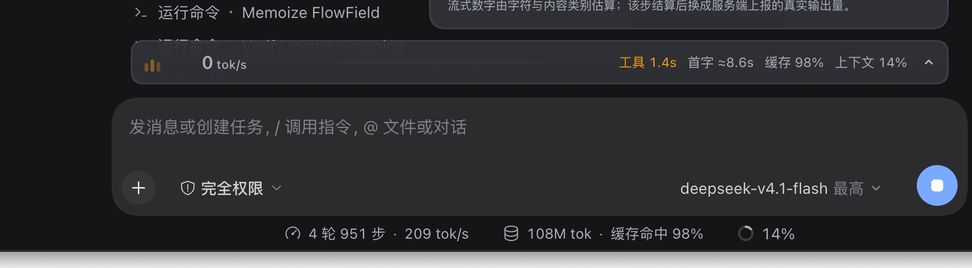
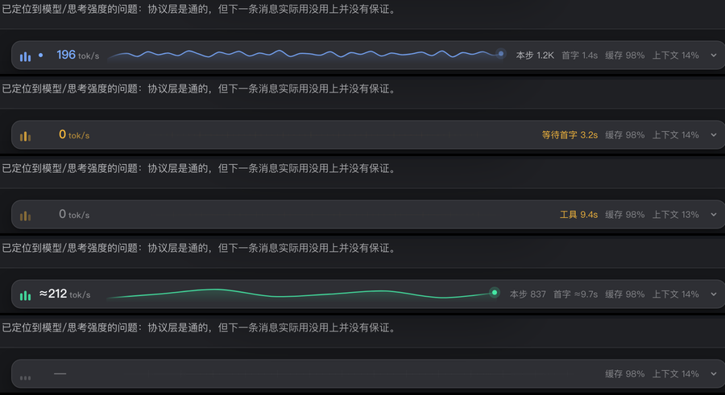
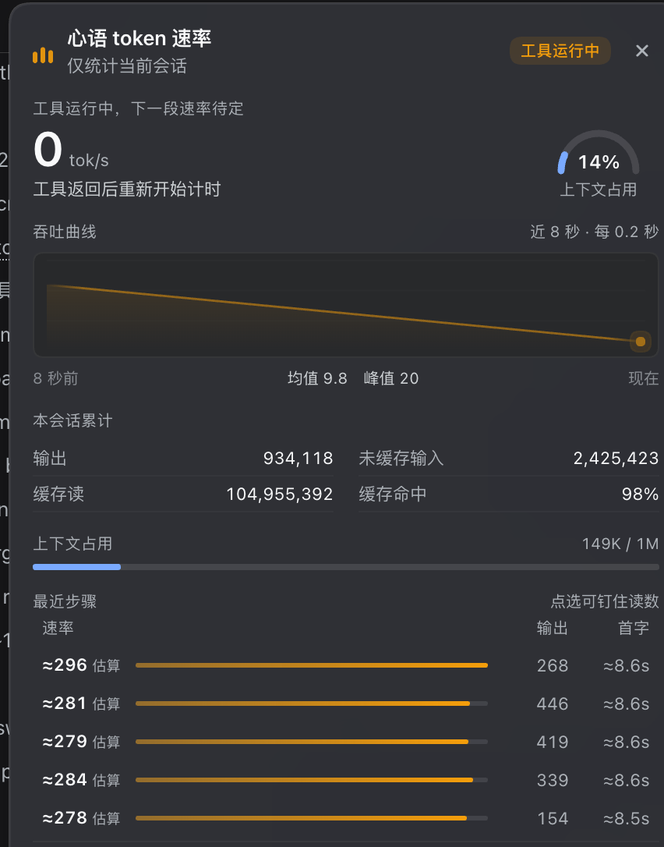

# 心语 Token 速率 · dsh-xinyu-token-rate

输入框上方的一条 token 吞吐仪表。给 DeepSeek Harness 的对话界面加一个常驻读数：**现在每秒生成多少 token、这次首字等了多久、缓存命中多少、上下文还剩多少**。

零核心改动、零网络请求、零构建步骤——纯 client 插件，只占 `conversation.input.dock` 一个停靠位。



## 它长什么样

整条高 36 px，与输入框同宽对齐，从右往左依次是：状态标记、**速率**、8 秒吞吐曲线、四个解释性读数、展开箭头。点击整条打开详情面板。



| 状态 | 显示 | 说明 |
| --- | --- | --- |
| 生成中 | 实时速率 + 滑动曲线 | 蓝色波形，跟随最近一秒的窗口速率 |
| 等待首字 | `0 tok/s` + `等待首字 3.2s` | 琥珀色，一条带刻度的发丝基线在呼吸 |
| 工具运行中 | `0 tok/s` + `工具 9.4s` | 期间不产出 token，所以不显示上一轮的假尖峰 |
| 已结算 | `≈212 tok/s` | 换成服务端上报的真实用量反推的速度 |
| 空闲 | `—` | 完全静止，CPU 占用 0 |

## 详情面板



- **上一轮平均**大数字 + 半圆上下文占用表
- **近 8 秒吞吐曲线**：每 0.2 秒一根柱子，均值与峰值；在曲线上横向拖动可以读到任意一根柱子的速率和它距今多久
- **本会话累计**：输出、未缓存输入、缓存读、缓存命中率
- **最近步骤**：每步的速率、输出 token、首字延迟。点任意一行可以把它钉到大数字上，再点一次解除

## 安装

### 方式一：DSH 插件页（推荐）

在 DSH 的「插件」页选择**从本地目录安装**，指向本仓库克隆下来的目录即可。插件自带 `cordis.patch.yml` 并声明了 `dsh.bundle.patch`，安装后自动注册、自动挂载，无需手写配置。

### 方式二：命令行

```sh
# git 依赖，固定 tag
dsh plugin --profile desktop add 'dsh-xinyu-token-rate@github:su2517108202-blip/xinyu-token-rate#v1.2.0'

# 或本地 link（改代码即时生效）
git clone https://github.com/su2517108202-blip/xinyu-token-rate.git
dsh plugin --profile desktop add link:$PWD/xinyu-token-rate
```

安装后**刷新浏览器**（Cmd/Ctrl + R）。link 安装会在每次保存 `client.js` 后由宿主 HMR 自动热更，连刷新都不需要。

> **无构建步骤**：`client.js` 是已经组装好的浏览器 bundle，`npm install` / `pnpm install` 都不需要跑（仓库没有运行时依赖）。

### 让 DSH 自己装

把这段发给任意 DSH 会话：

> 帮我安装心语 Token 速率插件：`git clone https://github.com/su2517108202-blip/xinyu-token-rate.git`，然后用 `plugin_manager` 的 `install_bundle` 把克隆目录装到当前 profile，装完刷新页面确认输入框上方出现速率条。

## 数字是怎么来的

插件只读宿主已经公开的两个快照投影与对话节点树，不请求任何接口。

**生成中**：把流式增量按字符类别（中日韩、拉丁、数字、代码标点）折算成 token，再用本会话**已完成步骤上报的真实用量**做 ridge 回归校准。回放 2534 个真实步骤：估算误差中位数 **6.5%**，实时窗口速率 **4.3%**。

**结算后**：直接用服务端上报的 `outputTokens` 除以解码窗口。但回放的步骤没有首字时间戳——宿主只在实时流里记录它——所以解码窗口由「步骤时长、输出量、提示量」三个量回归重建：

```
ln(decode_ms) = 4.8189 + 0.2902·ln(span) + 0.9687·ln(out) - 0.4987·ln(prompt)
```

留一会话交叉验证 2556 个步骤，误差中位数 **26%**（不重建、直接拿整段步骤时长当解码窗口是 **59%**）。**凡是估算出的值都带 `≈` 前缀**；每行的 token 数始终是服务端上报的真实值，所以即使速率是估算，累计量也是准的。

复现方法见下文「基准」。

## 一年不刷新也不掉帧：动效成本

所有动效都是 CSS 合成器动画（`opacity` / `transform`），没有 canvas、没有逐帧 JS。唯一按时间重算的是 150 ms 一次的采样，而它只在模型正在输出时才跑。

| 状态 | CPU 增量（2× 缩放，GPU 合成，相对无插件页面） |
| --- | --- |
| 空闲 / 已结算 / 出错 | **0%** |
| 生成中 | **~3%** |
| 等待首字 / 工具运行 | **~3%** |

> 在 macOS 2× Retina 下，页面上哪怕只有一个 8 px 圆点做最简单的 `opacity` 呼吸，Chromium 合成器唤醒的固定底噪就是 ~3%——生成中的 ~3% 就是保留动态反馈的物理下限。开启系统「减弱动态效果」后全部归零。

内存：与不带插件相比 V8 heap 差 **0.3 MB**，且是一次性的 DOM 与样式；滑动窗口 `bars` 固定截断到 40 个数字、校准只扫最近 120 步，**不随会话长度增长**。

## 兼容性

| 项 | 要求 |
| --- | --- |
| DSH | 0.2.x（在 0.2.2-rc.3 上开发与验证） |
| 平台 | Web GUI（`dsh.client.platform = "web"`） |
| 宿主模块 | `@deepseek-ai/dsh-client-locale`、`@deepseek-ai/dsh-client-ui-conversation` |
| 浏览器 | 支持 `@layer`、`corner-shape`、`color-mix()` 的现代 Chromium / Safari |

插槽：`conversation.input.dock`，`order: 15`（位于 goal 之后、queue 之前）。所有样式包在 `@layer xinyu-token-rate` 内，不污染宿主层叠；尺寸与配色全部取自宿主的 `--dsw-*` / `--dsh-*` token，跟随亮暗主题。

## 基准

仓库里带一套可复现的测量脚本，它们不 mock：直接读你本机的 DSH 会话日志，和 `client.js` 里**正在发布的估算器**比对。

```sh
# 1. 导出会话（需要 zstd；日志含你的对话内容，导出到 .sessions/ 且已被 git 忽略）
node scripts/extract-sessions.mjs

# 2. 重跑两组基准
npm run bench
```

```
$ node bench/verify_client.mjs        # 流式估算器
sessions 23 · measured steps 2534 · 94899 samples
final token error  median 6.5%  p75 13.1%  p90 21.4%
live rate error    median 4.3%  p75 9.3%   p90 14.8%

$ node bench/verify_rate.mjs          # 结算后解码速率
sessions 18 · steps 2556
rate error         median 26.1% p75 46.0% p90 65.7%
off by >3x         78 steps (3.1%)
stamped steps      exact 2574          # 有真实首字时间戳时与真值一致
```

`bench/sweep_*.mjs` 是当初用来选模型的对照脚本（线性 / 对数线性 / 特征消融 / 留一会话交叉验证），保留下来是为了让上面那组系数可以被重新推导，而不是一个魔数。

数字会随会话集不同而小幅浮动——换成你自己的日志跑出来的值才是对你的真实误差。

## 项目结构

```
client.js              浏览器端全部逻辑与样式（无构建，直接可装载）
index.js               宿主端占位（本插件没有 host half）
cordis.patch.yml       bundle 补丁：注册 id 并挂载 client half
locale/{zh,en}.json    插件元信息（标题、描述、详情页）
docs/                  详情页文档、预览图、五种状态图
bench/                 可复现的估算器基准
scripts/               会话日志导出（zstd → jsonl）
```

## 已知限制

- **只统计当前会话**。切换会话即重置曲线与校准样本；不跨会话累计，也不读全局统计。
- **回放的历史步骤首字延迟是估算的**。宿主只为实时流记录 `firstTokenTime`，所以打开一个旧会话时，面板里的首字列会带 `≈`。
- **极短步骤的速率会被门限挡掉**。解码窗口不足 400 ms 或输出不足 20 token 的步骤不显示速率（`—`），避免几十毫秒的窗口算出四位数速率。
- 详情面板打开时 CPU 会升到 ~15%（面板自身的毛玻璃与图表扫光）。这是用户主动打开的状态，未做进一步削减。

## 许可

MIT。
