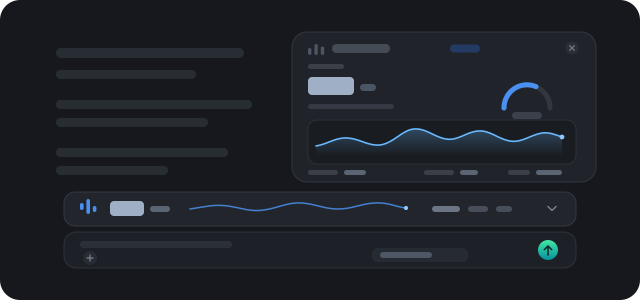

# Xinyu Token Rate

A token-throughput gauge for the message composer. It reads the conversation this
session already loaded — no extra requests, no telemetry, no stored history.

## What it shows

The dock is one row: state mark, rate, an 8-second throughput curve, and the
readings that explain the number.

| Reading | Meaning |
| --- | --- |
| **Rate** | Completion tokens per second over the newest one-second window while streaming, then the settled value the provider reported |
| **Curve** | 40 buckets of 200 ms, self-scaled to the observed band so a steady stream still shows its shape |
| **Step** | Output tokens of the current or last step |
| **TTFT** | Time from step start to the first token; `~` marks an estimate |
| **Cache** | Share of billed prompt tokens served from cache |
| **Context** | Projected pressure against the context window |

## Interaction

- Press the dock anywhere to open the detail panel; press it again, `Escape`, or
  outside the panel to close it.
- Drag across the curve to read the rate of any one bucket, then release to
  return to the window average and peak.
- Press a row under **Recent steps** to pin that step to the hero reading;
  press it again to release.
- The bar stays 36 px at every width, drops chips from right to left on narrow
  windows, and honours `prefers-reduced-motion`.

## Where the numbers come from

Streaming numbers come from the streamed characters, classified by script
(CJK, Latin, digits, code punctuation) and refined by a per-session ridge fit
against the reported usage of earlier settled steps. On 1317 replayed steps the
estimate lands at a **5.7 % median error**, and the live window rate at
**3.6 %**.

A replayed step carries no first-token stamp — the host records it from live
stream deltas only — so the settled decode window is reconstructed from step
length, output size and prompt size. Scored leave-one-session-out over 1346
steps that is a **25 % median error**, against 59 % for using the whole step
window, and it is marked `≈` wherever it appears. Every row keeps the
provider-reported token count, so totals are exact even where the rate is not.

## How the motion runs

Everything is composed CSS (`opacity`, `transform`) — no canvas, no per-frame
JavaScript. The only clock is the 200 ms sample, and it runs only while the
model is writing: idle, settled and error are completely still, at 0 % of the
main thread. When the window is hidden, samples are not even committed.

- The reading eases only when its whole-number digits change, so it renders
  as often as you can actually see.
- The dock keeps a single infinite loop; the other states are expressed with
  static opacity differences.
- The curve fades at both ends through its stroke gradient rather than a
  container mask, and the frosted layer stays on the floating panel only —
  the bar itself uses the 94 %-opaque surface token.

## Cost

| State | CPU (above a page without the widget) | Note |
| --- | --- | --- |
| idle / settled / error | **0 %** | completely still; nothing is animating |
| writing | ~3–4 % | the curve and its head — the one loop that means "moving" |
| waiting / tooling | ~3–4 % | the hairline breathing slowly |

The memory cost is a fixed DOM and stylesheet; there is no structure that
grows while the session runs. Figures are the per-tab delta at 2× scale with
GPU compositing on, against a baseline page that already spends ~3 % on its
own rendering.

## Notes

- Only the current session is counted; switching sessions resets the curve.
- Nothing leaves the page: the plugin registers one dock slot and one locale
  namespace.
